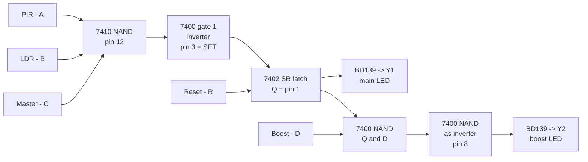

# Smart Room Lighting Controller: Logic IC Simulation

A top-down **Java 8 Swing / Java 2D** simulation of a microcontroller-free room lighting controller built from basic logic ICs (**7410, 7400, 7402**).

A person walks into a room. A **PIR** sensor detects the motion, an **LDR** sensor reports that it is dark, and the gates decide to switch the lights on. An **SR latch** (two cross-coupled NOR gates) then *remembers* the decision, so the lights stay on even when the person sits still and the PIR goes quiet. A **reset** button clears the memory, and a **boost** switch adds a second brightness stage.

Every signal change is shown live in a colour-coded console, so you can watch the logic work step by step.

---

## Features

- Top-down Java 2D room with a door, desks, PIR detection cone, LDR, window and four ceiling lights (two main **Y1**, two boost **Y2**).
- A person who walks in through the door, stands still, or walks out.
- A PIR model that detects **movement only**, with a hold time like the HC-SR501.
- Day / Night toggle (LDR), Master switch, Boost switch and a **hold-to-reset** button.
- Live signal panel showing A, B, C, D, R, the NAND output, SET, Q, Q̄, the boost NAND and Y2.
- Highlighted light events: a green flash and banner when a light comes **ON**, red when it goes **OFF**.
- In-window console with colour-coded lines, **Clear all**, **Auto-scroll** and an optional mirror to the IDE console.
- Handles the forbidden **S = R = 1** case: it prints a warning and the latch settles randomly when released, as real hardware can.
- Pure Java 8, one source file, no external libraries.

---

## How it works

### Inputs and outputs

| Signal | Source | Meaning |
|---|---|---|
| **A** | PIR sensor | 1 = motion detected |
| **B** | LDR module | 1 = room is dark |
| **C** | Master switch | 1 = system enabled |
| **D** | Boost switch | 1 = boost enabled |
| **R** | Reset button | 1 = clear the latch (while held) |
| **Y1** | Q of the latch | Main light |
| **Y2** | Q · D | Boost light |

### Logic equations

```
SET = A · B · C
Q   = NOR(R, Q̄)
Q̄   = NOR(SET, Q)
Y1  = Q
Y2  = Q · D
```

### Block diagram



### Chip mapping

| Chip | Part | Role in the simulation |
|---|---|---|
| 7410 | Triple 3-input NAND | Gate 1: `NAND(A, B, C)` |
| 7400 | Quad 2-input NAND | Gate 1: inverter, makes SET. Gate 2: `NAND(Q, D)`. Gate 3: inverter, makes Y2 |
| 7402 | Quad 2-input NOR | Gates 1 and 2: SR latch (Q on pin 1, Q̄ on pin 4) |
| BD139 | NPN transistor | Drives each LED stage (hardware build) |

---

## Hardware reference (optional breadboard build)

The simulation mirrors a real breadboard design. Pin numbers are from the **top view** with the notch up: pins 1 to 7 run down the left side and pins 8 to 14 run up the right side.

### 7410 (3-input NAND x3)

| Pin | Connection |
|---|---|
| 1 | PIR OUT (A) |
| 2 | LDR OUT (B) |
| 13 | Master switch (C), plus 10 kΩ to GND |
| 12 | Output, to 7400 pins 1 and 2 |
| 3, 4, 5, 9, 10, 11 | GND (unused gates) |
| 6, 8 | Leave open (unused outputs) |
| 14 / 7 | +5 V / GND |

### 7400 (2-input NAND x4)

| Pin | Connection | Function |
|---|---|---|
| 1, 2 | 7410 pin 12 (tied together) | Gate 1 inverter |
| 3 | 7402 pin 5 | **SET** |
| 4 | 7402 pin 1 (Q) | Gate 2 input |
| 5 | Boost switch (D), plus 10 kΩ to GND | Gate 2 input |
| 6 | Pins 9 and 10 | Gate 2 output |
| 9, 10 | Pin 6 (tied together) | Gate 3 inverter |
| 8 | 1 kΩ to BD139 #2 base | **Y2** |
| 11 | Leave open | Unused |
| 12, 13 | GND | Unused |
| 14 / 7 | +5 V / GND | |

### 7402 (2-input NOR x4)

| Pin | Connection | Function |
|---|---|---|
| 1 | Pin 6, 7400 pin 4, 1 kΩ to BD139 #1 base | **Q** (Y1) |
| 2 | Reset button, plus 10 kΩ to GND | **Reset** |
| 3 | Pin 4 | Feedback |
| 4 | Pin 3 | **Q̄** |
| 5 | 7400 pin 3 | **SET** |
| 6 | Pin 1 | Feedback |
| 8, 9, 11, 12 | GND | Unused |
| 10, 13 | Leave open | Unused |
| 14 / 7 | +5 V / GND | |

### Other parts

| Part | Notes |
|---|---|
| 9 V battery, switch, 7805 | 5 V supply, 1000 µF on input, 100 µF on output |
| 0.1 µF capacitors | One across VCC and GND near each IC |
| PIR (HC-SR501) | OUT to 7410 pin 1 |
| LDR module | OUT to 7410 pin 2, adjust the pot so OUT is HIGH when dark |
| BD139 x2 | Emitter to GND, collector to LED cathode, base through 1 kΩ |
| LED stages | Anode through 220 Ω to 5 V |

Use **74LS** or **74HCT** parts. The HC-SR501 output is only about 3.3 V when HIGH, which plain 74HC may not read reliably at 5 V supply.

---

## Requirements

- **Java 8 or newer** (JDK)
- Any IDE, or just the command line. The project was written for **NetBeans** (Java 8 / Swing).

## Build and run

### NetBeans
1. Create a new Java project (Java Application).
2. Add `SmartRoomSim.java` to the default package.
3. Run the file.

### Command line
```bash
git clone https://github.com/stark9000/smart-room-light-sim.git
cd smart-room-light-sim
javac SmartRoomSim.java
java SmartRoomSim
```

---

## Controls

| Control | What it does |
|---|---|
| **Walk IN to sensors** | The person walks through the door to the spot under the PIR |
| **Stop (stand still)** | Stops the person where they are (the PIR goes quiet after its hold time) |
| **Walk OUT of door** | The person walks back out |
| **RESET (hold)** | Momentary reset (R = 1 while held) |
| **Boost: ON/OFF** | Boost switch (D) |
| **Master: ON/OFF** | Master switch (C) |
| **Night / Daylight** | Sets the LDR (B): Night = dark = 1 |
| **Clear all** | Empties the console |
| **Auto-scroll** | Follows the newest console line |
| **Also print to NetBeans console** | Mirrors console output to standard output |

## Console colours

| Colour | Meaning |
|---|---|
| Green background, black text | Light **ON** event |
| Red background, white text | Light **OFF** event |
| Cyan | Events (buttons, person entering, leaving or stopping) |
| Grey, starting with `~` | Individual signal changes, with the reason |
| Green | Full STATE line (every signal, every pin) |
| Bold orange | Warnings, such as the forbidden S = R = 1 case |

Example output:

```
[00:11.092]   ~ A  PIR out : 0 -> 1   (motion detected inside PIR cone)
[00:11.092]   ~ SET (7400 p3) : 0 -> 1   (SET active (occupied + dark + master))
[00:11.093]   ~ Q (7402 p1) = Y1 : 0 -> 1   (latch ON -> main light Y1 ON)
 [00:11.093]  LIGHT ON   >>  Y1 MAIN LIGHT
[00:11.093] STATE A=1 B=1 C=1 D=0 R=0 | 7410.p12=0 7400.p3(SET)=1 | 7402.p1(Q)=1 p4(Qbar)=0 | 7400.p6=1 p8(Y2)=0 | Y1=ON Y2=OFF
```

---

## Things to try

| # | Scenario | What you should see |
|---|---|---|
| 1 | Night, press **Walk IN** | The PIR detects the person in its cone, SET goes to 1, Q latches to 1 and Y1 comes on |
| 2 | Wait for the person to stop | The PIR drops after about 1.5 s and SET returns to 0, but Y1 **stays on** (memory) |
| 3 | Turn **Boost** on | Y2 comes on (Q = 1 and D = 1) |
| 4 | Turn **Daylight** on | The room brightens, but the latch still holds the lights on until reset |
| 5 | Press **Reset** with the person standing still | Q goes to 0 and Y1 and Y2 both turn off |
| 6 | Hold **Reset** while the person is moving in the cone | S = 1 and R = 1: warning printed, and the latch settles randomly after release |
| 7 | Turn **Master** off, then walk in | SET stays 0 and nothing latches |

---

## Tweaking the simulation

All the main settings are constants near the top of `SmartRoomSim.java`:

| Constant | Effect |
|---|---|
| `PIR_HOLD_TICKS` | How long the PIR output stays HIGH after motion (1 tick = 30 ms) |
| `PIR_RANGE`, `PIR_HALF_ANGLE` | Size of the PIR detection cone |
| `SPEED` | Walking speed in pixels per tick |
| `Y1_LIGHTS`, `Y2_LIGHTS` | Positions of the ceiling lights |
| `MAX_CONSOLE_LINES` | How many console lines are kept |
| `initStyles()` | Console colours |

---

## Limitations

- **No automatic off.** Lights stay on until someone presses Reset. This is how the original design behaves. A timeout or an exit sensor driving R would fix it.
- **PIR sees movement, not presence.** It cannot confirm that the room is empty, so Reset is only reliable when no one is moving.
- **Reset and SET together.** If Reset is released while the PIR is still HIGH, SET can re-latch the lights.
- **The latch start state is unpredictable** on real hardware at power-up. Press Reset once after switching on.
- The BD139 stage suits small LEDs. Real mains lighting needs a relay or a proper driver.

---

Inside `SmartRoomSim.java`:

| Part | Purpose |
|---|---|
| `nand2`, `nand3`, `nor2` | Gate primitives (the chips) |
| `NorLatch` | Cross-coupled NOR SR latch with feedback settling and metastable handling |
| `Controller` | Wires the gates together exactly like the breadboard |
| `ScenePanel` | Java 2D drawing: room, sensors, lights, person, flash effects, signal panel |
| `tick()` | 30 ms simulation loop: person, PIR, reset, logic, logging |
| `log...` / `emit` | Styled in-window console and standard output |

---

## Credits

The circuit idea comes from a **university digital logic coursework project** (a smart classroom latching light controller). This repository is an independent Java simulation of that idea, and the circuit has been corrected and generalised for any room.

## Licence

Released under the **MIT Licence**. See `LICENSE`.

```
MIT License

Permission is hereby granted, free of charge, to any person obtaining a copy
of this software and associated documentation files (the "Software"), to deal
in the Software without restriction, including without limitation the rights
to use, copy, modify, merge, publish, distribute, sublicense, and/or sell
copies of the Software, and to permit persons to whom the Software is
furnished to do so, subject to the following conditions:

The above copyright notice and this permission notice shall be included in all
copies or substantial portions of the Software.

THE SOFTWARE IS PROVIDED "AS IS", WITHOUT WARRANTY OF ANY KIND, EXPRESS OR
IMPLIED, INCLUDING BUT NOT LIMITED TO THE WARRANTIES OF MERCHANTABILITY,
FITNESS FOR A PARTICULAR PURPOSE AND NONINFRINGEMENT. IN NO EVENT SHALL THE
AUTHORS OR COPYRIGHT HOLDERS BE LIABLE FOR ANY CLAIM, DAMAGES OR OTHER
LIABILITY, WHETHER IN AN ACTION OF CONTRACT, TORT OR OTHERWISE, ARISING FROM,
OUT OF OR IN CONNECTION WITH THE SOFTWARE OR THE USE OR OTHER DEALINGS IN THE
SOFTWARE.
```
